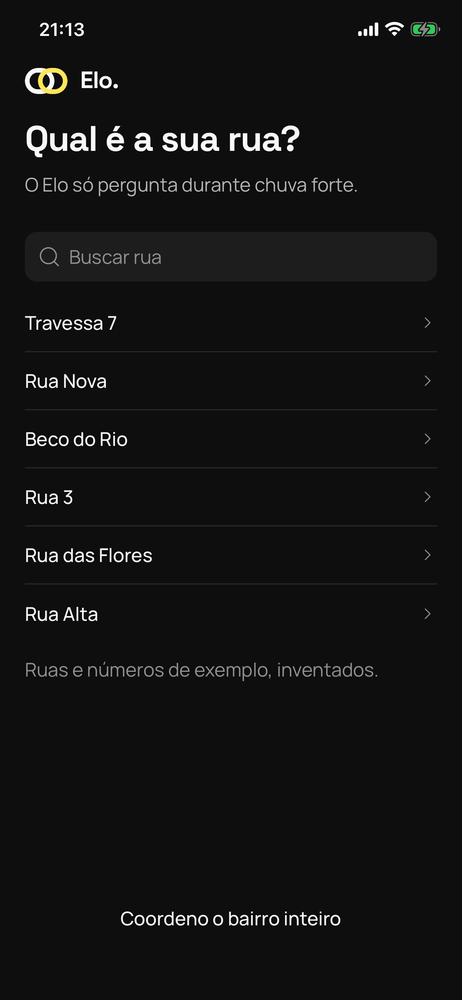
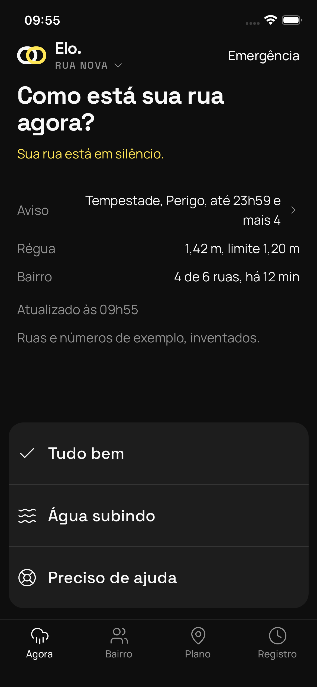
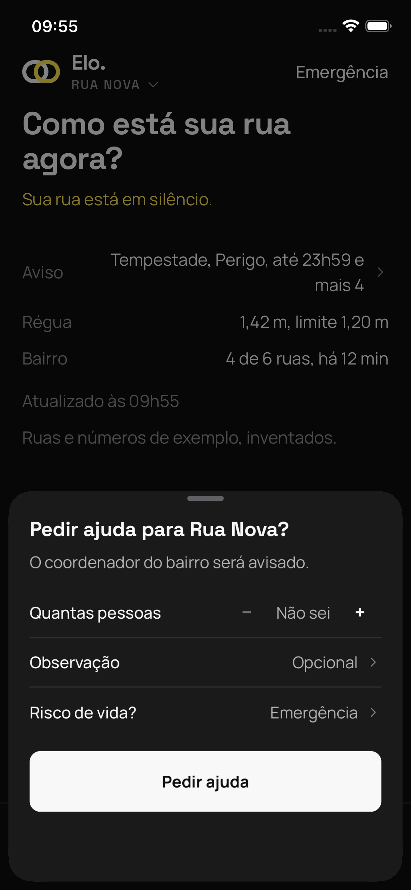
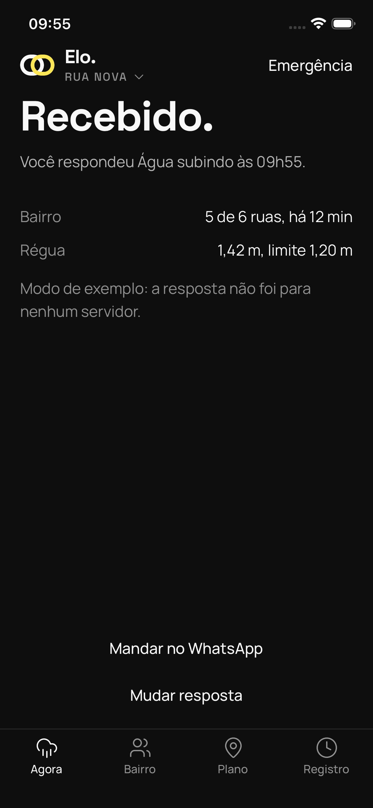
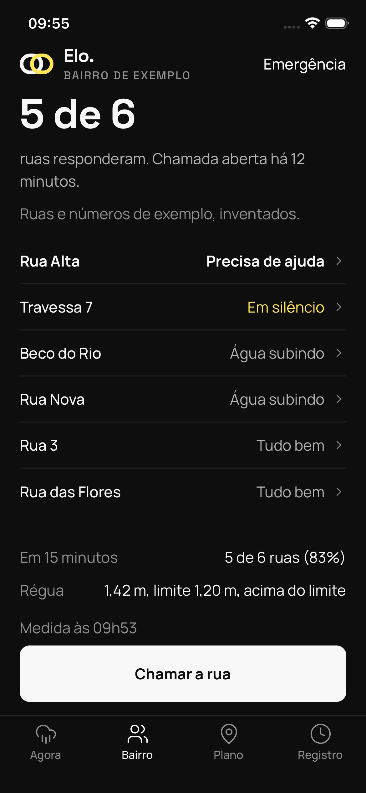
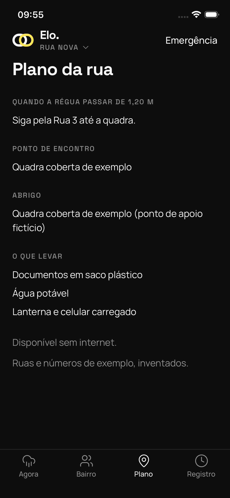
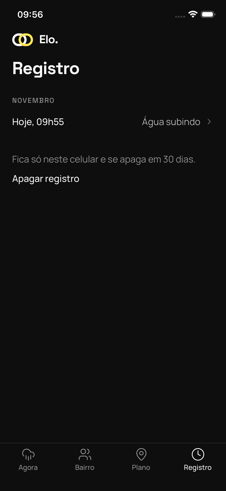

# Elo

## Ficha da CitizenTech

| Campo | Resposta |
| --- | --- |
| Nome da CitizenTech | Elo (provisório) |
| Cidade e bairro | São Paulo. Bairro a definir; candidato: Jardim Pantanal |
| Cidadão beneficiado | Moradores de ruas que alagam, por meio da liderança da rua ou do voluntário do núcleo comunitário de Defesa Civil |
| Problema, em uma frase | Durante a chuva forte, quem cuida do bairro não consegue saber quais ruas estão bem, quais precisam de ajuda e quais ficaram em silêncio. |
| Como funciona | O aviso oficial chega ao coordenador, a liderança de cada rua responde em um toque, mesmo com internet ruim, e o painel destaca as ruas sem resposta. Um sensor mede a água no ponto crítico. |
| O que cada parte faz | App: aviso, chamada, plano e registro. API: guarda as chamadas e ordena as ruas em silêncio. ESP32: mede a água e toca o buzzer. ML: indica o nível de atenção por subprefeitura. Segurança: evita vazamento do que é digitado. Linux: hospeda a API. Testes: requisitos e casos de teste. |
| Link do repositório | [preencher] |
| Indicador de impacto | Percentual de ruas com situação conhecida em 15 minutos, comparando o simulado sem e com o app |
| ODS conectados | ODS 11 (meta 11.5) e ODS 13 (meta 13.1) |

App da CitizenTech **Elo**, feito para a Global Solution 2026.2 da FIAP (disciplina de Mobile). A liderança da rua faz a chamada durante a chuva forte (tudo bem, água subindo, preciso de ajuda), e o coordenador do bairro vê quais ruas ficaram em silêncio, mesmo com internet ruim. Sem nomes de moradores, e o morador não instala nada.

## Integrantes

| Nome | RM |
| --- | --- |
| João | [preencher] |
| Bruno | [preencher] |
| Rodrigo | [preencher] |
| Lucca | [preencher] |
| Ruan | [preencher] |

## Como rodar

Precisa de Node.js e, no celular, do app Expo Go (SDK 58) ou de um emulador.

```bash
npm install
cp .env.example .env     # veja a seção seguinte
npx expo start
```

Escaneie o QR code com o Expo Go. Outros comandos:

| Comando | O que faz |
| --- | --- |
| `npm run typecheck` | Confere os tipos (TypeScript) |
| `npm test` | Roda os testes (Jest), sem chamar a internet |

## Variáveis de ambiente (`.env`)

O arquivo `.env` fica fora do repositório (está no `.gitignore`). O `.env.example` mostra o formato.

| Variável | Para que serve |
| --- | --- |
| `EXPO_PUBLIC_USE_MOCK` | `true`: INMET, Open-Meteo e a API do bairro usam dados de exemplo. A tela "Trocar área" continua usando a internet. |
| `EXPO_PUBLIC_API_URL` | Endereço da API do bairro (C#), sem barra no final. Vazio: usa os dados de exemplo. |

Nenhum serviço usado exige chave de acesso. As variáveis `EXPO_PUBLIC_*` ficam visíveis dentro do app, por isso nunca devem guardar segredo. Reinicie o Expo depois de mudar o `.env`.

## Telas e navegação

Navegação com Expo Router (`app/`), em TypeScript, com quatro abas (Agora, Bairro, Plano e Registro), telas internas que mantêm as abas visíveis e folhas que sobem da parte de baixo (`formSheet`).

| Rota | Tela | O que faz |
| --- | --- | --- |
| `inicio` | Primeiro uso | Escolhe a rua, ou "Coordeno o bairro inteiro". Só aparece uma vez. |
| `(tabs)/(agora)/index` | Agora | Com chamada aberta, as três respostas em um toque. Depois de responder, "Recebido." ou "Guardado.", com "Mudar resposta". Sem chamada, aviso, chuva, régua e "Treinar a chamada". Quando a régua passa do limite, a leitura aparece no alto, com atalho para o Plano. |
| `(tabs)/(agora)/aviso` | Detalhe do aviso | Avisos do INMET, o que fazer, riscos, chuva das próximas 3 horas e envio pelo WhatsApp. |
| `(tabs)/bairro/index` | Bairro | "4 de 6" ruas, lista com quem pediu ajuda primeiro, indicador de 15 minutos, régua e "Chamar as 2 ruas". |
| `(tabs)/bairro/[id]` | Rua | Situação, ponto de encontro, rota de saída, "Chamar no WhatsApp" e "Vou até lá". |
| `(tabs)/plano` | Plano da rua | Rota, encontro, abrigo e o que levar. Abre sem internet. |
| `(tabs)/registro/index` | Registro | Respostas guardadas no SQLite, por mês, pendentes, "Tentar enviar de novo" e "Apagar registro". |
| `(tabs)/registro/[id]` | Detalhe da resposta | Dados da resposta, envio por SMS ou WhatsApp. |
| `ajuda` (folha) | Preciso de ajuda | Quantas pessoas, observação e telefones de emergência. |
| `emergencia` (folha) | Emergência | Liga para 199 ou 193. O atalho fica no topo das abas. |
| `area` (folha) | Trocar área | Troca a rua e a área, com um campo só para CEP ou distrito. |
| `+not-found` | Tela não encontrada | Mensagem em português com volta ao início. |

Toda tela trata **carregando**, **erro** (com "Tentar de novo") e **vazio**.

## Design e biblioteca de UI

A regra do app: **caixa nunca guarda informação; caixa só marca onde tocar agora**. No máximo um bloco com fundo por tela. Detalhes, tokens e módulos em [`docs/design.md`](docs/design.md).

| Biblioteca | Para quê |
| --- | --- |
| [NativeWind](https://www.nativewind.dev/) com Tailwind | Estilo por classes, alimentado pelas cores de `src/theme` |
| [React Native Reusables](https://reactnativereusables.com/) | Base de `src/components/ui` (botão, texto, campo e linha), copiada para o projeto e adaptada (licença MIT em `src/components/ui`) |
| Lucide | Ícones |
| Space Grotesk e Manrope | Fontes, pelo `@expo-google-fonts` |
| Reanimated e expo-haptics | Entrada suave e vibração ao responder |
| NetInfo | Reenvio automático quando a internet volta |

## De onde vêm os dados

Só serviços gratuitos e sem chave. O acesso à rede fica em `src/services`; as telas nunca chamam `fetch`.

| Fonte | Uso | Real ou exemplo |
| --- | --- | --- |
| INMET (`apiprevmet3.inmet.gov.br/avisos/ativos`) | Avisos de chuva por município | **Real**. Com `EXPO_PUBLIC_API_URL`, o app pede à API do bairro (`GET /avisos?codigoIbge=`), que já filtra o município (algumas centenas de bytes em vez de 580 KB). Com `EXPO_PUBLIC_USE_MOCK=true`, vira aviso fictício. |
| Open-Meteo | Chuva prevista nas próximas 3 horas | **Real**. Com `EXPO_PUBLIC_USE_MOCK=true`, vira previsão fictícia. |
| BrasilAPI e ViaCEP | CEP para nome da área, código IBGE e coordenadas | **Real**, sempre. |
| IBGE (serviço de localidades) | Distritos de São Paulo | **Real**, sempre. |
| API do bairro (C#, repositório `elo-api-csharp`) | Situação das ruas (com percentual "sem o app" e coordenadas), envio da chamada, régua d'água, plano da rua e avisos | **Real** com `EXPO_PUBLIC_API_URL` (por exemplo `http://<ip-da-maquina>:5080`). Sem ela, os dados vêm de `src/mocks` e são fictícios. Contrato em [`docs/contrato-api.md`](docs/contrato-api.md). |
| Sensor ESP32 (régua d'água) | Nível da água, com nível de atenção, limite e posição | **Real** quando a API tem leituras; a régua chega ao app pelo `GET /regua` da API, nunca direto. Sem API, exemplo. |

Com `EXPO_PUBLIC_API_URL`, os dados do bairro são reais e as telas deixam de dizer "exemplo". Na aba Bairro, quando há chamada aberta, aparece a linha "Sem o app" (o percentual medido antes do Elo, para comparar com o "Em 15 minutos"), a régua mostra "em atenção" quando a API manda o nível de atenção, e a tela da rua ganha "Ver no mapa" se a API mandou a posição da rua. Todos esses campos são opcionais: com uma API antiga, o app funciona como antes.

As ruas, o bairro e os planos de exemplo são inventados: nenhum dado pessoal real. Dado de exemplo nunca parece real: as telas dizem isso em uma linha de texto, a resposta não aparece como enviada a um servidor e as mensagens de SMS e WhatsApp saem com a palavra "EXEMPLO". Na ausência do `.env`, os avisos e a chuva são reais e só os dados do bairro são de exemplo.

Se a internet falhar, o app mostra o último dado guardado com o aviso "Salvo às 21h13, pode estar desatualizado" (cache no SQLite; se for de outro dia, mostra a data). Aviso do INMET que já acabou sai da lista, e a chuva das próximas 3 horas é refeita para a hora atual a partir da previsão guardada. Com internet, o plano de todas as ruas é guardado em segundo plano para abrir depois sem sinal. A resposta que não conseguiu sair é reenviada sozinha quando a internet volta ou quando o app volta para a frente.

## Banco de dados: SQLite

Escolhemos o **SQLite** (`expo-sqlite`) porque funciona **sem internet**, que é justamente a situação da chuva forte, e é **gratuito** e já vem no Expo. Só a pasta `src/db` fala com o banco (camada própria); as telas usam as funções de lá ou os serviços.

| Tabela | Guarda |
| --- | --- |
| `chamadas` | Cada chamada: rua, situação, pessoas, observação, hora e se já chegou ao servidor |
| `cache` | Última resposta de cada consulta (avisos, previsão, bairro, planos) |
| `configuracoes` | Área escolhida, rua da liderança e se o primeiro uso já foi feito |
| `visitas` | Ruas marcadas com "Vou até lá", só o id da rua e a chamada |

- Estrutura versionada por migrações (`PRAGMA user_version`).
- Chamadas e visitas com mais de 30 dias são apagadas sozinhas ao abrir o app, e o registro pode ser apagado a qualquer momento.
- O arquivo do banco continua `elo-da-chuva.db`, do nome antigo, para não perder o que já estava guardado.
- Nunca guardamos nome de morador. A observação traz o aviso para não escrever nome, CPF nem dado de saúde, não vai para log nem para o cache, e o app lembra que ela vai junto nas mensagens de SMS e WhatsApp.
- No Android, o backup automático do app está desligado, para o registro não sair do aparelho.

## Acessibilidade

- Contraste mínimo de 4,5:1 nos pares de texto, nos temas claro e escuro (verificado em teste automático).
- Fonte base de 16; 12 só em rótulo curto e na aba. O texto acompanha o tamanho da fonte do sistema, com um teto nos títulos para não quebrar palavra no meio.
- Áreas de toque de pelo menos 48.
- Todo elemento interativo tem `accessibilityRole` e `accessibilityLabel`; opções de escolha usam `radio` com o estado marcado, e o leitor de tela anuncia o número de pessoas ao mudar.
- A cor nunca está sozinha: todo estado vem escrito ("Água subindo", "Em silêncio"), e o dourado só aparece no silêncio.
- Linguagem simples, sem sigla sem explicação.

## Aderência ao tema

O app serve ao ODS 11 (meta 11.5, reduzir mortes e perdas por desastres) e ao ODS 13 (meta 13.1, resiliência a riscos do clima). O indicador de impacto aparece na tela Bairro: percentual de ruas com situação conhecida em 15 minutos. O app **não cria alertas de chuva próprios**: ele leva o aviso oficial (INMET) até a rua e sempre mostra 199 (Defesa Civil) e 193 (Bombeiros). O aviso da régua é outra coisa: é a medição do sensor no local, mostrada como leitura, e só aparece com o app aberto.

## Prints

Tirados no simulador de iPhone. Os avisos vêm do INMET; as ruas e os números do bairro são de exemplo. Refaçam os prints antes da entrega, quando o app estiver final.

| Primeiro uso | Agora | Preciso de ajuda | Recebido |
|---|---|---|---|
|  |  |  |  |

| Bairro | Plano | Registro |
|---|---|---|
|  |  |  |

## Vídeo

[preencher]

## Limites conhecidos

- **Sem push remoto no Expo Go.** O app não recebe notificação com o app fechado; o aviso chega pela abertura do app ou pelo WhatsApp do bairro.
- **O JSON do INMET é pesado** (cerca de 580 KB, com polígonos). Em rede ruim a busca pode demorar, e por isso o último aviso fica guardado no celular.
- **O app não envia SMS sozinho.** Ele abre o app de mensagens do aparelho com o texto pronto, e a pessoa escolhe o destinatário. Aparelho sem SMS (tablet, simulador) mostra uma mensagem clara.
- **A API do bairro precisa estar no ar para os dados serem reais.** Ela existe (`elo-api-csharp`), mas o app só a usa com `EXPO_PUBLIC_API_URL`; no celular, use o IP da máquina na mesma rede (`http://<ip-da-maquina>:5080`), não `localhost`. Sem ela, os dados são de exemplo.
- **Sem login e sem chave por aparelho.** Quem tem o endereço da API lê a situação do bairro e envia chamadas. A chave existe só para o ESP32.
- **"Sem o app" é um valor medido uma vez**, num simulado, e vem pronto da API: o app só mostra. "Ver no mapa" abre o app de mapas do aparelho e depende da posição que a API guarda para a rua; rua sem coordenada não tem o botão.
- **A régua é uma só no app.** Mesmo com várias na API, o `GET /regua` devolve a régua padrão do bairro.
- **Sem internet na primeira vez**, não há lista de ruas para escolher, e a chamada não pode ser feita: a lista precisa ser carregada uma vez com internet. Nesse caso, ligue 199 ou 193.
- A previsão por distrito (sem CEP) usa o centro de São Paulo, por isso é aproximada.
- Enxurrada rápida não dá tempo de chamada: o Elo serve para água que sobe aos poucos.
- Os testes cobrem serviços, banco (mapeamentos e migração), domínio e tema. As telas ainda não têm teste automático.
- O app roda em iOS e Android. A versão web não é um alvo (o `expo-sqlite` precisaria de outra configuração).
- **Registro mostra as respostas deste celular.** O histórico de cada chamada do bairro depende da API.
- **"Vou até lá" fica só neste celular** até a API ter onde guardar. "Treinar a chamada" não grava nem envia nada.
- **Testado em simulador de iPhone.** Falta testar em Android, em celular real, sem internet de verdade (o teste simulou a API fora do ar), SMS, WhatsApp, ligação e VoiceOver.

## Estrutura

```
app/            rotas (Expo Router)
src/components/ módulos reutilizáveis (ui/ é a base do React Native Reusables)
src/theme/      cores, fontes, espaçamentos (único lugar com valores fixos)
src/services/   acesso à rede (INMET, Open-Meteo, CEP, IBGE, API do bairro) e cache
src/db/         acesso ao SQLite
src/domain/     regras puras (ordenar ruas, textos de SMS e WhatsApp, formatação)
src/hooks/      hooks das telas
src/lib/        utilitário de classes
ferramentas/    gerador do ícone e da abertura
src/mocks/      dados fictícios
docs/           contrato da API, design e prints
```

O registro do uso de IA está em [`prompts.md`](prompts.md).
